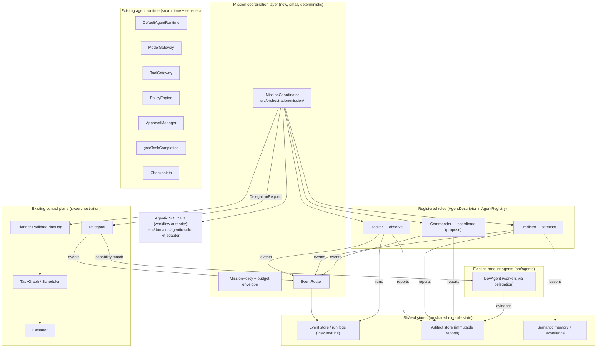
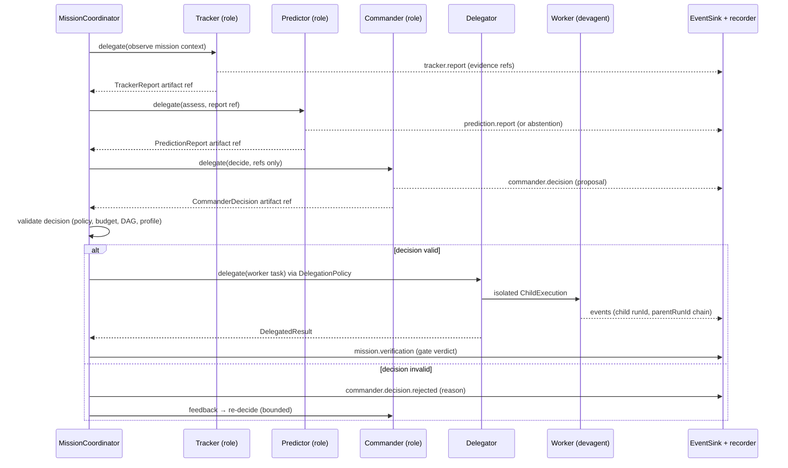
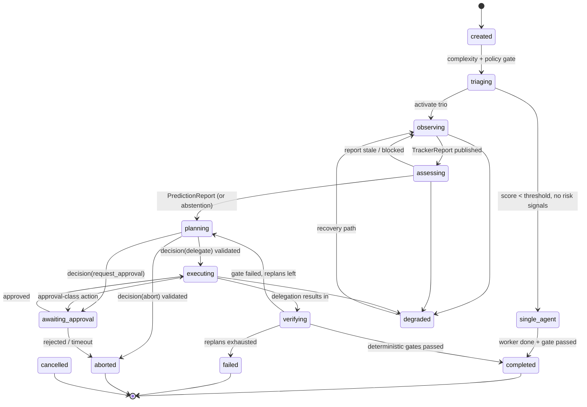
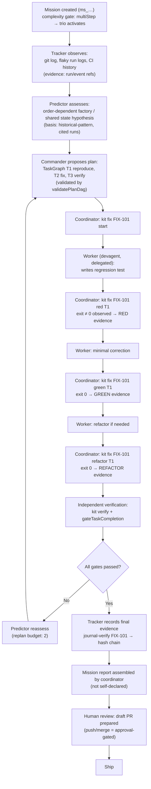

# Nexum Multi-Agent Coordination v1 — Engineering Specification

| | |
| --- | --- |
| **Status** | Draft for implementation (P0) |
| **Version** | 1.0.0-draft1 |
| **Date** | 2026-11-26 |
| **Companion ADR** | `docs/adr/ADR-0001-multi-agent-coordination-layer.md` |
| **Companion docs** | `ROADMAP.md`, `TEST-STRATEGY.md`, `THREAT-MODEL.md`, `RISK-REGISTER.md`, `OPS-RUNBOOK.md` |
| **Pinned baseline** | `shubhamtaywade82/nexum` @ `3d2c1d02ce7e2c206db3e7888c2753cf0c52e6ef` (main, 2026-11-22); `agentic-sdlc-kit` main (AGENTS.md, README.md) |
| **Related repos docs** | `docs/guide/architecture.md`, `docs/ISSUE_AUTOMATION.md`, `SECURITY.md`, `STABILITY.md` |

> All component names, file paths and API signatures in this spec were
> verified against the pinned baseline. Appendix A records the verification
> register, including the claims that needed correction. Where this spec
> proposes **new** code, it says so explicitly.

---

## Table of contents

1. [Purpose, scope and non-goals](#1-purpose-scope-and-non-goals)
2. [Verified baseline — what Nexum already provides](#2-verified-baseline--what-nexum-already-provides)
3. [System architecture](#3-system-architecture)
4. [Role specifications](#4-role-specifications)
5. [Event and artifact contracts](#5-event-and-artifact-contracts)
6. [Storage architecture](#6-storage-architecture)
7. [Mission lifecycle](#7-mission-lifecycle)
8. [Capability and permission model](#8-capability-and-permission-model)
9. [Autonomy profiles](#9-autonomy-profiles)
10. [Agentic SDLC Kit adapter — full design](#10-agentic-sdlc-kit-adapter--full-design)
11. [Mission coordinator design](#11-mission-coordinator-design)
12. [Budgets and loop prevention](#12-budgets-and-loop-prevention)
13. [Human interaction and approvals](#13-human-interaction-and-approvals)
14. [Observability and audit](#14-observability-and-audit)
15. [Evaluation framework](#15-evaluation-framework)
16. [Implementation module layout](#16-implementation-module-layout)
17. [End-to-end execution example](#17-end-to-end-execution-example)
- [Appendix A: Verification register](#appendix-a-verification-register)
- [Appendix B: Consolidated TypeScript contracts](#appendix-b-consolidated-typescript-contracts)
- [Appendix C: Event catalog](#appendix-c-event-catalog)
- [Appendix D: Glossary](#appendix-d-glossary)

---

## 1. Purpose, scope and non-goals

### 1.1 Purpose

Nexum coordinates work through a single interactive agent plus first-class
delegation to child agents. This specification adds a **three-role
coordination layer** — **Tracker** (observe), **Predictor** (forecast),
**Commander** (coordinate) — that turns a high-level engineering mission
("investigate why the RSpec suite is intermittently failing and fix the root
cause") into an evidence-driven, budgeted, verifiable execution, while every
 consequential action still flows through Nexum's deterministic control plane.

### 1.2 Goals

- G1 — Specialized division of labor with **enforced capability scoping**
  (each role sees only the tools its posture allows).
- G2 — **Evidence-grounded** observation, prediction and decision-making:
  every published claim cites evidence references.
- G3 — **Auditable missions**: complete event trail, immutable report
  artifacts, deterministic replay.
- G4 — **Bounded autonomy**: hard budgets, bounded replanning, explicit
  approval gates, no infinite loops.
- G5 — **Deterministic workflow authority**: when a mission binds to the
  Agentic SDLC Kit, phase transitions (RED/GREEN/REFACTOR/VERIFY) are decided
  by the Kit, never by an LLM.
- G6 — **Graduated rollout**: the trio activates only when a request justifies
  it; a typo fix stays a single-agent turn.

### 1.3 Non-goals

- A new agent runtime, message bus, consensus engine or supervisor loop
  (removed with `src/multiagent`; see ADR-0001).
- Prompt-level "teamwork" as a security boundary.
- Replacing `Planner`/`Scheduler`/`Executor`/`Delegator`; the coordinator uses
  them.
- Autonomous publishing: `git push`, PR merge, release and any DESTRUCTIVE
  class operation remain human-gated in all production profiles (matching
  both `SECURITY.md` §5–§6 and the Kit's AGENTS.md safety boundaries).
- A multi-agent layer as a defense against malicious code. `SECURITY.md` §12
  is explicit: this is not a sandbox; untrusted workloads belong on a
  disposable machine.

### 1.4 Terminology

See Appendix D for the glossary (mission, role, worker, evidence reference,
report artifact, capability tag, posture, permission class, autonomy profile).

---

## 2. Verified baseline — what Nexum already provides

Everything in this section was confirmed in the pinned baseline. The mapping
table is the core of the "no duplicate runtime" argument.

### 2.1 Existing capabilities the design reuses

| Needed capability | Existing component (verified path) | Notes for this design |
| --- | --- | --- |
| Agent identity & registration | `AgentRegistry`, `AgentDescriptor` — `src/runtime/agent/agent-runtime.ts` | `register(descriptor)`, `get`, `require`, `all`, `ids`, `supports` |
| Capability-based selection | `AgentRegistry.selectFor(required: string[]): AgentDescriptor[]` | "Tightest overlap first" — exact-set satisfaction then overlap sort |
| Delegation | `Delegator` — `src/orchestration/delegation/delegator.ts` | `review()` decides without executing; `delegate()` returns `ChildExecution`; `observe()`/`aggregate()` fold results |
| Execution orchestration | `Planner` (`planner.ts`), `TaskGraph` (`src/core/tasks/task-graph.ts`), `Scheduler` (`src/core/tasks/scheduler.ts`), `Executor` (`executor.ts`) | DAG validation: `validatePlanDag` / `sanitizePlanDag` (`dag-validator.ts`) |
| Loop prevention | `LoopDetector` — `src/orchestration/loop-detector.ts` (kernel contract in `src/core/loop`) | Reused for mission replan detection |
| Complexity gating | `assessComplexity(message)` — `src/orchestration/complexity.ts` | Deterministic, no model call; `MULTI_STEP_THRESHOLD = 3` |
| Budgets | `BudgetManager` — `src/runtime/budget/budget-manager.ts`; `deriveChild({budget?, share?})` | Child consumption propagates upward |
| Cancellation | `CancellationRegistry`/`CancellationScope` (`src/core/cancellation`); `DefaultAgentRuntime.cancel(runId)` | Reaches model calls, tools, shell, children |
| Tool governance | `ToolGateway` — `src/tools/gateway/tool-gateway.ts`; pipeline: registry → schema validation → capability check → policy check → budget guard → idempotency → executor | Single enforcement point for the capability matrix |
| Policy | `PolicyEngine` (`RulePolicyEngine`): first-decision-wins, denials first; postures `parity`/`standard`/`restricted`; execution profiles `readonly`/`development`/`testing`/`devops`/`networked`/`production` | Role postures map onto these |
| Approvals | `ApprovalManager` — `src/cli/services/approval-manager.ts` (runtime service); owns the kernel `ApprovalBroker` — `src/core/policy/approval-broker.ts` (both exports verified on the baseline; F-4 outcome) | Auto-approve off by default (`NEXUM_AUTO_APPROVE`) |
| Events | `EventEnvelope` — `src/core/events/envelope.ts` (`id`, `seq`, trace/run/task/tool/model id chain, `parentRunId`); `EventSink` (`src/core/types.js`) | Mission events ride this envelope; no new bus |
| Durable recording | `RunRecorder` — `src/runtime/persistence/execution-recorder.ts`; run logs in `.nexum/runs`; queryable via `session_events`/`session_trace` | Mission events are recorded, replayable |
| Checkpoints | `src/runtime/checkpoint.ts`; `.nexum/checkpoint.json`; plans checkpointed per step transition | Mission checkpoint schema extends this |
| Verification gate | `gateTaskCompletion` — `src/runtime/verification-gate.ts` | Task `running → completed` only when the deterministic contract passes |
| Mission phase model | `MissionState`, `createMissionState`, `deriveMissionPhases` — `src/runtime/mission-derive.ts` | Plan/Execute/Complete/Understand/Inspect/Validate/Repair/Review phases; reused, not replaced |
| Artifacts | `src/artifacts`; oversized tool outputs stored as artifacts (`artifact_read`) | Report artifacts land here |
| Memory | `src/memory`; semantic memory (`docs/guide/semantic-memory.md`) | Historical lessons for Predictor |
| Learning | `src/learning`; `ExperienceStore` (`src/evolution/experience`) | Optional experience ingestion (P7+) |
| Evaluation | `src/evaluation` (`nexum eval`), `src/benchmark` | Role evaluation suites integrate here |
| Isolated experimentation | evolution worktrees; `EvolutionVerificationProfile` | Research profile reuses worktree isolation |
| SDLC Kit bridge (existing) | `src/tools/sdlc-tools.ts` — `resolveKitCliPath()`, `executeKitCommand(args, cwd, timeoutMs)`, tools `sdlc_inspect`, `sdlc_validate_spec`, `sdlc_validate_plan`, `sdlc_verify`, `sdlc_doctor` | The adapter **extends** this; see §10 |

### 2.2 Baseline caveats the design must respect

1. **Published package ≠ main.** `package.json` says `2.0.0`; `CHANGELOG.md`
   has an `Unreleased` section (DevAgent-era compat removal). Pin source
   revisions in tests and in the pilot; never assume the npm tarball equals
   `main`.
2. **`AgentDescriptor.capabilities` is optional** and the default
   `devAgentDescriptor()` factory declares no `capabilities` array. Delegation
   by capability therefore fails (returns no match) until worker descriptors
   declare capability tags. P1 adds them — this is a schema-compatible,
   non-breaking change.
3. **`Delegator.matchByCapability` is first-match over `agents.all()`**, not
   `selectFor()`'s ranked overlap. It satisfies `required.every(r => caps.includes(r))`
   on the first descriptor in registration order. The mission coordinator must
   therefore either pin `childAgentId` or register workers in a deterministic,
   documented order (P5 addresses this; see RISK-REGISTER R-07).
4. **`src/multiagent` is gone** (removed 2.0.0-alpha.5; restore via
   `git checkout 01b42ab -- src/multiagent tests/multiagent`). Nothing in this
   spec may recreate message-bus/shared-state/consensus semantics.
5. **`SECURITY.md` §12 residual gaps apply unchanged**: Docker daemon access
   is root-equivalent; the `github` tool can act on issues/PRs with your token;
   there is no formal audit; Docker Desktop is not covered by `test:docker`.
   The multi-agent layer neither widens nor claims to narrow these.

---

## 3. System architecture

### 3.1 Layered view



Rules:

- The roles are **advisors with tools scoped to read-only-ish postures**; they
  never execute each other, never write each other's state, and never share
  memory beyond typed artifacts.
- The **only writer of mission state** is the `MissionCoordinator`, a
  deterministic state machine — the same "LLM proposes, runtime decides"
  pattern Nexum already applies in the trading pipeline and the evolution
  plane.
- The **only executor of work** is the existing runtime through `Delegator`
  → workers (DevAgent and future product agents).
- Workers are ordinary registered agents; the coordinator may also execute
  tasks in-process where no agent tools are needed (e.g., Kit phase
  transitions are CLI invocations owned by the adapter, not delegated).

### 3.2 Where new code goes

| New module | Location | Plane |
| --- | --- | --- |
| Role agents + contracts | `src/agents/tracker/`, `src/agents/predictor/`, `src/agents/commander/` | Product-agent layer (same as `devagent`) |
| Mission coordinator, mission policy, event router | `src/orchestration/mission/` | Control plane |
| SDLC Kit adapter (extends `src/tools/sdlc-tools.ts`) | `src/domains/agentic-sdlc-kit/` | Domain layer |
| Role evaluation cases | `src/evaluation/multi-agent/` | Evaluation |
| Mission events, report artifact schemas | `src/agents/*/contracts.ts` + `src/orchestration/mission/events.ts` | Contracts near their owners |

The layering test (`tests/architecture/layering.test.ts`) is extended in P0
to forbid: `src/orchestration/mission/**` importing from `src/ui/**`,
`src/agents/**` or `src/domains/**`; `src/agents/{tracker,predictor,commander}/**`
importing from `src/orchestration/**` (they consume runtime/core contracts
only); `src/domains/agentic-sdlc-kit/**` importing from `src/ui/**`.

---

## 4. Role specifications

Each role is specified by: mission, responsibilities, inputs, outputs
(TypeScript contract), grounding rules (what the LLM may and may not assert),
registration (the exact `AgentDescriptor`), and failure behavior.

Common registration pattern (verified fields from
`src/runtime/agent/agent-runtime.ts`):

```ts
export interface AgentDescriptor {
  id: AgentId;
  displayName: string;
  defaultCapability: "coding" | "vision" | "reasoning" | "quick" | "tools" | "agentic";
  defaultStrategy: StrategyName;
  allowedPackIds?: string[];      // capability scoping (tool packs)
  capabilities?: string[];       // delegation matching + tool discovery
  description?: string;
  requiredTools?: string[];
  allowedPolicies?: string[];    // accepted postures
  supportedStrategies?: StrategyName[];
  supportedModels?: string[];
}
```

The coordinator instantiates each role through the normal
`DefaultAgentRuntime.execute(request, context)` path — the roles get **no**
privileged entry points. Posture enforcement is the `PolicyEngine`'s job at
the `ToolGateway`; `allowedPolicies` on the descriptor is the declared
contract, and P1 adds a registry test that refuses a role whose runtime
posture is weaker than its declared one.

### 4.1 Tracker — observe and understand the environment

**Mission.** Continuously collect and correlate evidence about the mission's
environment and publish an honest `TrackerReport`.

**Responsibilities.**

- Repository state: structure, code changes, diffs (deterministic git reads).
- Git history: branches, commits, PR status (via the existing governed `git`
  and `github` tools, read-only verbs only).
- Test execution, build results, diagnostics.
- Agent execution traces and tool failures (run logs, `session_events`).
- Task status and dependency progress (TaskGraph snapshot).
- CI/CD events and workflow results.
- Runtime resource and model usage (budget snapshots, telemetry).

**Inputs.** Mission context; read-only repository access; event-store queries;
artifact reads; budget/telemetry snapshots. No writes anywhere.

**Outputs (contract).**

```ts
export type EvidenceRef =
  | `artifact:${string}`   // immutable artifact id
  | `event:${string}`      // EventEnvelope id
  | `run:${string}`        // recorded run id
  | `checkpoint:${string}` // mission checkpoint id;

export type ObservationKind =
  | "repository" | "tests" | "ci" | "agent-trace"
  | "task-status" | "resources";

export interface Observation {
  kind: ObservationKind;
  summary: string;              // <= 500 chars, factual
  detail?: string;              // structured detail, <= 8 KiB
  evidenceRefs: EvidenceRef[];  // MUST be non-empty (validated)
  observedAt: string;          // ISO 8601
  staleAfter?: string;          // ISO 8601 — freshness bound
}

export interface DetectedChange {
  kind: "code" | "test" | "config" | "docs" | "ci" | "environment";
  subject: string;              // path, ref, workflow id, ...
  before?: string;
  after?: string;
  evidenceRefs: EvidenceRef[];
}

export interface Blocker {
  kind: "permission-denied" | "tool-failure" | "missing-dependency"
      | "timeout" | "external-unavailable" | "contradictory-evidence";
  description: string;
  evidenceRefs: EvidenceRef[];
  suggestedUnblock?: string;
}

export type TrackerHealth = "healthy" | "degraded" | "blocked";

export interface TrackerReport {
  reportId: string;              // `tr_` + uuid
  missionId: string;
  timestamp: string;
  observations: Observation[];  // may be empty only with health explanation
  detectedChanges: DetectedChange[];
  blockers: Blocker[];
  health: TrackerHealth;
  healthRationale: string;       // required when health !== "healthy"
  evidenceRefs: EvidenceRef[];   // report-level evidence (superset union)
  schemaVersion: 1;
}
```

**Grounding rules (enforced, not prompt-only).**

1. **Deterministic collectors first.** Observation gathering is implemented as
   deterministic tool calls (git log/diff/status, test runner output, CI
   queries, run-log reads). The LLM component only summarizes and correlates
   what the collectors returned; it never asserts repository state without a
   collector result behind it.
2. **No evidence, no observation.** Contract validation drops (and logs)
   any `Observation` with empty `evidenceRefs`. An observation citing
   evidence that does not resolve (artifact missing, event id unknown) is a
   contract violation, surfaced as a `Blocker` with kind
   `contradictory-evidence`.
3. **Freshness.** `staleAfter` bounds how long the coordinator may reuse the
   report; expired reports force re-observation before decisions that depend
   on them.
4. **Failure honesty.** Collector failures become `Blocker`s, never silence.

**Registration (P1).**

```ts
export function trackerDescriptor(): AgentDescriptor {
  return {
    id: "tracker",
    displayName: "Mission Tracker",
    description: "Observes repository, tests, CI, agent traces and budgets; publishes evidence-grounded observations.",
    defaultCapability: "tools",
    defaultStrategy: "react",
    capabilities: ["observe", "evidence-collection", "mission-reporting"],
    allowedPackIds: ["filesystem-read", "search", "git-readonly", "github-readonly", "session-history", "artifacts-read"],
    allowedPolicies: ["readonly", "restricted"],
    requiredTools: [],           // no writes, no shell
    supportedStrategies: ["react", "plan_execute"],
  };
}
```

(Pack ids are finalized against `src/tools/packs` in P1; the names above are
the required semantic scope, and the P1 acceptance test asserts the mounted
pack contains no write/execute-class tool.)

**Failure behavior.** If Tracker cannot produce a report (all collectors
failing), it publishes a report with `health: "blocked"`, one `Blocker` per
failure, and no observations — the coordinator then may not proceed to
execution decisions (see §7 transitions).

### 4.2 Predictor — forecast risks and recommend next actions

**Mission.** Consume Tracker reports, historical artifacts and previous
mission outcomes to produce evidence-backed risk assessments and
recommendations, with explicit abstention under insufficient evidence.

**Responsibilities.**

- Predict task completion risks (per TaskGraph node).
- Identify probable implementation failures (from diffs + history).
- Detect dependency bottlenecks (DAG shape + historical durations).
- Estimate verification effort.
- Recommend alternative execution paths.
- Identify repetitive agent failure patterns (run-log + experience store).
- Flag when a stronger model or different tool is required.

**Inputs.** Latest `TrackerReport`; prior mission artifacts; semantic memory
lessons; experience records (when available); budget state.

**Outputs (contract).**

```ts
export type PredictionBasis =
  | "observed-fact"        // directly observed in cited evidence
  | "historical-pattern"  // pattern over cited historical records
  | "statistical"          // computed from a calibration dataset
  | "model-hypothesis"    // model-generated, not evidence-derived
  | "unknown";             // basis could not be established

export type Confidence = "low" | "medium" | "high";

export interface Prediction {
  subject: string;              // task id, file, dependency, mission outcome
  outcome: string;             // falsifiable statement of expected outcome
  /** Present ONLY when a calibration dataset covers this subject
   *  (see §15.3). Absent probability is not zero — it is "not estimable". */
  probability?: number;        // [0,1], calibrated
  confidence: Confidence;      // quality of available evidence
  basis: PredictionBasis;      // REQUIRED — "unknown" is a valid answer
  evidenceRefs: EvidenceRef[]; // MUST be non-empty unless basis === "unknown"
}

export type RiskSeverity = "low" | "medium" | "high" | "critical";
export type RiskCategory =
  | "implementation" | "dependency" | "verification" | "regression"
  | "resource" | "security" | "coordination";

export interface Risk {
  riskId: string;
  category: RiskCategory;
  description: string;
  severity: RiskSeverity;
  triggers: string[];            // observable conditions
  mitigation?: string;
  evidenceRefs: EvidenceRef[];
}

export interface Recommendation {
  targetAction: CommanderAction;      // §4.3 — advisory only
  rationale: string;
  expectedBenefit: string;
  evidenceRefs: EvidenceRef[];
}

export interface PredictionReport {
  reportId: string;              // `pr_` + uuid
  missionId: string;
  basedOnReportId: string;       // TrackerReport lineage (non-null)
  generatedAt: string;
  predictions: Prediction[];
  risks: Risk[];
  recommendations: Recommendation[];
  uncertainty: string[];         // what is NOT known — required, may be long
  abstained?: { reason: string; missingEvidence: string[] };
  schemaVersion: 1;
}
```

**Grounding rules (enforced).**

1. **Probability ≠ confidence.** `probability` requires a defined, measurable
   outcome and a calibration dataset that covers the subject
   (§15.3); `confidence` grades the evidence. A prediction MAY carry
   `confidence: "high"` and no `probability`. A prediction MUST NOT carry
   `probability` without `basis: "statistical"` and an evidence ref into the
   calibration dataset.
2. **Labeled bases.** Every prediction carries `basis`. `model-hypothesis`
   predictions are allowed (they are useful) but are surfaced as hypotheses
   everywhere downstream (mission report, TUI) and are never decision-sufficient
   for `complete` or `verify` actions.
3. **Abstention.** When required evidence is missing, Predictor MUST set
   `abstained` and MAY NOT emit recommendations. Abstention is a first-class,
   tested outcome (INV-8), not a failure.
4. **Lineage.** `basedOnReportId` must resolve to a non-stale TrackerReport;
   the coordinator rejects otherwise.
5. **No tool-side effects.** Predictor's packs are read-only; it cannot run
   tests, mutate state, or observe anything Tracker did not already collect.

**Registration (P1).**

```ts
export function predictorDescriptor(): AgentDescriptor {
  return {
    id: "predictor",
    displayName: "Mission Predictor",
    description: "Evidence-grounded risk assessment and forecasting; abstains when evidence is insufficient.",
    defaultCapability: "reasoning",
    defaultStrategy: "react",
    capabilities: ["predict", "risk-assessment", "analysis", "mission-reporting"],
    allowedPackIds: ["artifacts-read", "session-history", "memory-read"],
    allowedPolicies: ["readonly", "restricted"],
    supportedStrategies: ["react"],
  };
}
```

### 4.3 Commander — coordinate and control (by proposal)

**Mission.** Interpret mission objectives, consume Tracker and Predictor
reports, and propose the next mission action as a structured, re-validatable
decision.

**Responsibilities.**

- Interpret mission objectives and success criteria.
- Consume Tracker/Predictor reports (never raw conversation dumps).
- Propose TaskGraph construction and updates (as plan proposals validated by
  `validatePlanDag`).
- Propose delegations (goals + `requiredCapabilities`; the Delegator picks the
  worker).
- Select execution strategies within allowed sets.
- Propose budget allocations within the mission envelope.
- Propose retries and replans (bounded by mission policy).
- Request verification gates and Kit phase transitions.
- Request human approval when the profile requires it.
- Draft the final mission report (assembled by the coordinator, not
  self-declared).

**Outputs (contract).**

```ts
export type CommanderAction =
  | "delegate" | "replan" | "retry" | "verify"
  | "request_approval" | "complete" | "abort";

export interface DelegationProposal {
  goal: string;                       // becomes DelegationRequest.goal
  requiredCapabilities: string[];    // capability tags (P1 adds them to workers)
  input?: string;
  budgetShare?: number;               // within remaining mission budget
  maxToolTurns?: number;
  contextHandoff?: string[];          // distilled summaries, evidence refs
}

export interface CommanderDecision {
  decisionId: string;                 // `cd_` + uuid
  missionId: string;
  action: CommanderAction;
  rationale: string;
  taskIds?: string[];                 // affected TaskGraph nodes
  delegation?: DelegationProposal;     // iff action === "delegate"
  replan?: { reason: string; changedNodes: string[] };  // iff action === "replan"
  retry?: { taskId: string; attempt: number };          // iff action === "retry"
  approvalRequest?: {                 // iff action === "request_approval"
    subject: string;
    riskClass: "REMOTE" | "GITHUB" | "DESTRUCTIVE" | "financial";
    description: string;
  };
  basedOnReports: string[];           // tracker/predictor report ids — non-empty
  evidenceRefs: EvidenceRef[];
  schemaVersion: 1;
}
```

**Authority boundary (the load-bearing rule).** A `CommanderDecision` is a
**proposal**. The `MissionCoordinator` re-validates every decision
deterministically before acting (§11.4):

1. `action` is permitted by the mission's autonomy profile (§9).
2. `taskIds`/plan proposals pass `validatePlanDag`; invalid graphs are
   rejected, logged, and fed back as a coordination failure (never auto-fixed
   silently).
3. `delegation.budgetShare` is within the remaining budget and
   `DelegationPolicy` caps; the actual `DelegationRequest` is constructed by
   the coordinator, not trusted from the model.
4. `retry`/`replan` are within attempt and replan limits.
5. Anything approval-class routes through `ApprovalManager`
   (`docs/ISSUE_AUTOMATION.md` permission classes; Kit AGENTS.md boundaries):
   Commander cannot approve its own request.
6. `complete` requires deterministic verification evidence
   (`gateTaskCompletion` verdicts and/or Kit journal verification) — a
   Commander "complete" without evidence is rejected and logged.

**Registration (P1).**

```ts
export function commanderDescriptor(): AgentDescriptor {
  return {
    id: "commander",
    displayName: "Mission Commander",
    description: "Proposes mission actions from evidence; the deterministic coordinator validates and executes.",
    defaultCapability: "reasoning",
    defaultStrategy: "plan_execute",
    capabilities: ["coordinate", "mission-planning", "mission-reporting"],
    allowedPackIds: ["artifacts-read", "session-history", "memory-read", "mission-planning"],
    allowedPolicies: ["standard", "restricted"],  // never a permissive posture
    supportedStrategies: ["plan_execute", "react"],
  };
}
```

Commander has **no** direct code-write packs, no shell, no docker, no git
mutation tools. Implementation work happens only through delegated workers,
whose own postures apply.

---

## 5. Event and artifact contracts

### 5.1 Event envelope — extend, do not replace

Mission events ride the **existing** `EventEnvelope` (`src/core/events/envelope.ts`:
`id`, per-run `seq`, full id chain `traceId → runId → taskId/stepId →
toolCallId/modelCallId + parentRunId`). New work adds a mission-scoped payload
union and `missionId` in the event payload — it does not add a bus, a broker,
or a second envelope type.

```ts
// src/orchestration/mission/events.ts (new)
import type { TypeTaggedEvent } from "…/core/events/envelope.js";

export interface MissionEventBase extends TypeTaggedEvent {
  missionId: string;
  agentId: "tracker" | "predictor" | "commander" | "coordinator" | string;
  /** Immutable evidence references; non-empty on report/decision events. */
  evidenceRefs?: EvidenceRef[];
}

export type MissionEvent =
  | MissionEventBase & { type: "mission.created"; payload: MissionIntent }
  | MissionEventBase & { type: "mission.activated" | "mission.single_agent_fallback" }
  | MissionEventBase & { type: "tracker.report"; payload: TrackerReportRef }
  | MissionEventBase & { type: "prediction.report"; payload: PredictionReportRef }
  | MissionEventBase & { type: "commander.decision"; payload: CommanderDecisionRef }
  | MissionEventBase & { type: "commander.decision.rejected"; payload: DecisionRejection }
  | MissionEventBase & { type: "mission.delegation"; payload: DelegationLink }
  | MissionEventBase & { type: "mission.verification"; payload: VerificationVerdict }
  | MissionEventBase & { type: "mission.replan"; payload: ReplanRecord }
  | MissionEventBase & { type: "mission.approval.requested" | "mission.approval.resolved"; payload: ApprovalRecord }
  | MissionEventBase & { type: "mission.checkpoint"; payload: CheckpointRef }
  | MissionEventBase & { type: "mission.phase"; payload: PhaseTransition }
  | MissionEventBase & { type: "mission.completed" | "mission.failed" | "mission.aborted" | "mission.cancelled"; payload: MissionTermination };
```

Publishing goes through the standard `EventSink` (`src/core/types.js`) used by
the executing context, so events fan out live to the TUI store **and** persist
through the `RunRecorder` (`src/runtime/persistence/execution-recorder.ts`)
into `.nexum/runs` — the same dual path `DefaultAgentRuntime.execute` already
uses (`recorder ?? context.events`).

### 5.2 Reference-passing rule

Agents exchange **references** (`artifact:` ids and short structured refs),
never full conversation transcripts. A `TrackerReportRef` is
`{ reportId, artifactId, health, observationCount, blockerCount }` — enough
to route and summarize; full payloads live in the artifact store and are read
on demand. `DelegationRequest.contextHandoff` (existing field, verified)
carries **distilled summaries plus evidence refs**, capped in length by
mission policy (`maxContextHandoffChars`, default 32 KiB).

### 5.3 Report artifacts

Every role report is persisted as an **immutable artifact** following the
experiment-artifact pattern (`src/evolution/experiments/experiment-artifact.ts`):
written exclusively (`wx` — never overwritten), never mutated, self-hashed
(sha256 over the payload, recorded for integrity detection — explicitly
*not* tamper-proof, same caveat as evolution artifacts). Contract:

```ts
export interface ReportArtifact<T> {
  artifactId: string;          // `ma_` + uuid
  kind: "tracker-report" | "prediction-report" | "commander-decision"
      | "verification-evidence" | "mission-report";
  missionId: string;
  missionSeq: number;          // monotonic per mission
  createdAt: string;
  payload: T;                  // schema-validated before write
  sha256: string;              // integrity self-hash
  schemaVersion: number;
}
```

Writes are rejected (fail-closed) when the payload fails schema validation
(zod, consistent with the Kit's contracts approach and Nexum's dependency
set).

### 5.4 Event flow (nominal loop)



---

## 6. Storage architecture

Three stores with three distinct responsibilities. Nothing here is a shared
scratchpad.

| Store | Implementation (existing) | Holds | Mutability |
| --- | --- | --- | --- |
| Event store | Run logs `.nexum/runs` + `RunRecorder`; queryable via `session_events` / `session_trace` | What actually happened, in order, with the full id chain | Append-only |
| Artifact store | `src/artifacts` (+ `artifact_read` tool) | Reports, decisions, verification evidence, mission report | Immutable, self-hashed |
| Semantic memory | `src/memory` / semantic memory + `src/learning` experience | Reusable knowledge, historical lessons, labeled outcomes | Curated by existing memory tools |

Rules:

1. **Event store is the source of truth for "what happened"**; artifacts are
   the source of truth for "what was concluded"; memory is the source of
   truth for "what was learned". No role may write to another role's
   conclusions; corrections are new artifacts that supersede (with
   `supersededBy` in a new mission-report entry — artifacts themselves never
   change).
2. **Replay**: a mission audit is reconstructible from the event chain +
   artifact set alone (no LLM calls). This is an acceptance test (P7).
3. **Retention**: mission artifacts follow existing artifact retention;
   labeled prediction outcomes (§15.3) are retained for calibration with a
   minimum of 100 records before any `probability` is permitted in
   production profiles.
4. **Secrets**: artifacts pass through the same redaction boundary as
   persisted transcripts and memory (credential redaction is verified
   existing behavior); a report containing redacted content records the
   redaction count, not the content.

---

## 7. Mission lifecycle

### 7.1 States



`degraded` is a health overlay (from `TrackerHealth`), not a separate phase:
a mission in any active state may be marked degraded, which forces
re-observation before the next decision. It never unblocks by itself.

### 7.2 State rules

| Rule | Enforcement |
| --- | --- |
| Terminal states (`completed`, `failed`, `aborted`, `cancelled`) are **immutable** — a late cancel cannot rewrite a completed mission | Lifecycle state machine mirrors the `SubagentSession` terminal-state rule; tested in P5 |
| `completed` requires deterministic verification evidence attached (gate verdicts; Kit journal verification when bound) | `gateTaskCompletion` integration; tested in P5/P7 |
| Every transition emits `mission.phase` + a checkpoint | Coordinator implementation; replay-tested |
| `awaiting_approval` has a timeout (default 24 h) → `aborted` with reason `approval_timeout` | Mission policy |
| Replans are bounded (default 2 per mission, 1 per task); exhausted replans on gate failure → `failed` | Mission policy + `LoopDetector` |

### 7.3 Checkpoints and resume

Mission checkpoints extend the existing checkpoint behavior
(`src/runtime/checkpoint.ts`; plans checkpoint to `.nexum/checkpoint.json`
after every step transition) with a mission-scoped record in
`.nexum/missions/<missionId>/checkpoint.json`:

```ts
export interface MissionCheckpoint {
  missionId: string;
  seq: number;                       // matches last mission event seq
  state: MissionState;
  taskGraph?: TaskGraphSnapshot;     // node statuses
  pendingDelegations: string[];      // delegationIds in flight
  budgetConsumed: BudgetSnapshot;
  artifacts: string[];               // artifactIds so far
  createdAt: string;
}
```

**Resume semantics** (acceptance-tested): a resumed mission re-observes
(Tracker first), marks in-flight delegations of the previous incarnation as
`orphaned` (never silently re-runs non-idempotent operations — the idempotency
keys of the tool pipeline protect double execution), and re-enters the loop at
`observing`. Completed verified nodes are never re-executed.

### 7.4 Cancellation

`MissionCoordinator.cancel(missionId)` maps onto
`DefaultAgentRuntime.cancel(runId)` semantics: aborts the mission's
cancellation scope, which reaches in-flight model calls, tool calls, shell
containers and delegated children (`cancelWithParent` is the verified
`DelegationPolicy` default). Cancellation is recorded as a terminal
`mission.cancelled` event with the cancelled-scope count.

---

## 8. Capability and permission model

### 8.1 Capability matrix

Permission classes are the ones already documented in
`docs/ISSUE_AUTOMATION.md` (READ / WRITE / EXECUTE / NETWORK / REPOSITORY /
REMOTE / GITHUB / DESTRUCTIVE). The matrix below is **enforced by the
runtime** (pack mounting + `PolicyEngine` postures + `Delegator` policy), not
by prompts. "Recommend" means the role may propose it in a report; only the
marked actor may perform it.

| Capability (permission class) | Tracker | Predictor | Commander | Workers (delegated devagent) | Coordinator | Human |
| --- | --- | --- | --- | --- | --- | --- |
| Read repository (READ) | Yes | Yes | Yes | Yes | Yes | — |
| Read events/artifacts (READ) | Yes | Yes | Yes | Yes | Yes | — |
| Read semantic memory (READ) | Yes | Yes | Yes | Yes | Yes | — |
| Write memory (curated lessons) | — | — | — | via memory tools (policy) | — | — |
| Create plans (REPOSITORY-adjacent, orchestration-level) | — | — | Propose | — | Yes (validated DAG) | — |
| Delegate tasks (orchestration) | — | — | Propose | — | Yes (Delegator) | — |
| Modify source code (WRITE) | — | — | — | Yes, in write scope | — | — |
| Run tests/builds (EXECUTE, sandboxed) | — | — | — | Yes | — | — |
| Run Kit phase commands (EXECUTE, allowlisted) | — | — | — | — | Yes (adapter) | — |
| Network (NETWORK) | — | — | — | per policy | — | — |
| Commit / branch (REPOSITORY) | — | — | — | Yes (no push) | — | — |
| Push / remote (REMOTE) | No | No | No | No | No | **Approval only** |
| Open PR / comment (GITHUB) | No | No | No | No | No | **Approval only** |
| Destructive ops (DESTRUCTIVE) | No | No | No | No | No | **Approval only** |
| Approve own proposal | No (nobody approves own proposal) | — | — | — | — | Yes |

In `supervised` (default) and `controlled-autonomous`, REMOTE/GITHUB/DESTRUCTIVE
are approval-gated exactly as the existing `ApprovalManager` flow and Kit
AGENTS.md boundaries require. In no profile does a role approve its own
proposal.

### 8.2 Enforcement points

1. **Pack mounting** (`allowedPackIds`) — the tool set a role can even see.
2. **`PolicyEngine` posture per role execution** — `readonly`/`restricted`
   execution profiles for the three roles; workers keep their existing
   postures; `RulePolicyEngine` denials always run first.
3. **Delegation policy narrowing** — `DelegationPolicy.inheritPolicy` is
   narrow-only (verified default `true`): a child can never widen what the
   parent allowed; `allowedChildAgents` bounds the fan-out; caps
   (`maxConcurrentChildren` default 2, `maxTotalChildren` default 8) bound
   the blast radius.
4. **Coordinator decision re-validation** (§11.4) — even a compromised
   Commander cannot exceed the profile.
5. **`WorkspaceGuard` / sandbox / write scope** — unchanged and still the
   filesystem/shell boundary (`SECURITY.md` §2–§3). The multi-agent layer
   adds no new filesystem authority.

### 8.3 Capability tags

Workers must declare capability tags for capability-driven selection to work
(§2.2 caveat 2). P1 adds, at minimum:

```ts
// devagent descriptor gains (non-breaking, optional field):
capabilities: ["code-edit", "test-execution", "build", "repository", "diagnostics"]
```

Mission-declared worker requirements use the same vocabulary; a mismatch is a
**hard refusal** (`no registered agent satisfies capabilities [...]` —
verified `Delegator` behavior), surfaced as a mission blocker, never
silently widened.

---

## 9. Autonomy profiles

| | `supervised` (default) | `controlled-autonomous` | `research` |
| --- | --- | --- | --- |
| Who enables | default; no flag | explicit `NEXUM_MISSION_AUTONOMY=controlled` or config | explicit config + isolated workspace |
| Roles may investigate, predict, plan | Yes | Yes | Yes |
| Bounded reversible implementation (write scope, sandbox on) | Yes, in workspace | Yes | Yes, isolated worktree (evolution-worktree pattern) |
| Retry / replan within budgets | Yes (replan ≤ 2) | Yes | Yes |
| Open draft PR / comment | No — approval | No — approval | No — approval (prepare only) |
| Push / merge / release / DESTRUCTIVE | Human only | Human only | Human only |
| Experiments (benchmarks, alternative approaches) | — | — | Yes, isolated |
| Kit workflow driving | read + verify + propose | full TDD loop, publish gated | full TDD loop in worktree |
| Time budget (default) | 30 min | 60 min | 120 min |

Configuration (mission policy, `src/orchestration/mission/mission-policy.ts`):

```ts
export type AutonomyProfile = "supervised" | "controlled-autonomous" | "research";

export interface MissionPolicy {
  profile: AutonomyProfile;
  maxReplans: number;                 // default 2
  maxReplansPerTask: number;          // default 1
  maxRetriesPerTask: number;          // default 2
  budget: MissionBudgetEnvelope;      // §12
  delegationPolicy: DelegationPolicy;  // narrowed from defaults
  allowedActions: readonly CommanderAction[];
  approvalTimeoutMs: number;         // default 24 h
  maxContextHandoffChars: number;     // default 32_768
  requireKitWorkflow: boolean;        // mission bound to a Kit feature/fix
}

export const SUPERVISED_DEFAULTS: MissionPolicy = {
  profile: "supervised",
  maxReplans: 2,
  maxReplansPerTask: 1,
  maxRetriesPerTask: 2,
  budget: { wallClockMs: 30 * 60_000, maxModelCalls: 400, maxToolCalls: 1500,
            maxTokens: 2_000_000, maxChildren: 8, maxDepth: 1 },
  delegationPolicy: { maxConcurrentChildren: 2, maxTotalChildren: 8,
                      inheritPolicy: true, cancelWithParent: true },
  allowedActions: ["delegate", "replan", "retry", "verify", "request_approval", "complete", "abort"],
  approvalTimeoutMs: 24 * 3_600_000,
  maxContextHandoffChars: 32_768,
  requireKitWorkflow: false,
};
```

`research` additionally forces: sandbox worktree isolation, `writeScope`
narrowed to the worktree, and no GITHUB/REMOTE verbs anywhere in
`allowedActions` proposals that the coordinator will accept without approval.

The **production pilot (P8) runs `supervised`**, per ADR-0001. Expansion to
`controlled-autonomous` for a validated operation class requires: ≥ 20
missions of that class in the evaluation store, verified-completion rate
≥ 90%, zero false-success, zero permission-escalation findings — the same
evidence-first posture the evolution plane applies to harness promotion.

---

## 10. Agentic SDLC Kit adapter — full design

### 10.1 Starting point: the existing bridge is real

Verification found `src/tools/sdlc-tools.ts` already bridging the Kit with
`resolveKitCliPath()` (env `NEXUM_SDLC_KIT_PATH` / `AGENTIC_SDLC_KIT_PATH`,
disabled via `NEXUM_SDLC_KIT_DISABLED`), `executeKitCommand(args, cwd,
timeoutMs = 60_000)`, and five tools (`sdlc_inspect`, `sdlc_validate_spec`,
`sdlc_validate_plan`, `sdlc_verify`, `sdlc_doctor`) — all JSON-structured.
**The adapter extends this module; it does not duplicate it.**

What the existing bridge lacks for missions: the TDD phase machine
(`kit feature|fix <ID> start|red|green|refactor|verify`), the machine
protocol (`kit next --json`), and evidence auditing (`kit journal <ID>
--verify`) — precisely the pieces that make the Kit the workflow authority.

### 10.2 Adapter module

`src/domains/agentic-sdlc-kit/adapter.ts` (new):

```ts
export type SdlcKitCommand =
  | { op: "inspect"; path?: string }
  | { op: "doctor" }
  | { op: "validate-spec"; path: string }
  | { op: "validate-plan"; path: string }
  | { op: "verify"; path: string; dryRun?: boolean }
  | { op: "feature-phase"; featureId: FeatureId; taskId: TaskId;
      phase: "start" | "red" | "green" | "refactor" | "verify" }
  | { op: "fix-phase"; fixId: FeatureId; taskId: TaskId;
      phase: "start" | "red" | "green" | "refactor" | "verify" }
  | { op: "next" }                       // kit next --json
  | { op: "journal-verify"; runId: FeatureId };  // kit journal <ID> --verify

export type FeatureId = string & { __brand: "FeatureId" };  // ^[A-Z0-9][A-Z0-9-]*$
export type TaskId = string & { __brand: "TaskId" };        // ^TASK-[0-9]{3,}$

export interface SdlcKitResult<T> {
  ok: boolean;
  exitCode: number;
  parsed: T | null;        // JSON parsed when --json output present
  stderr: string;
  timedOut: boolean;
  durationMs: number;
  evidence: EvidenceRef[]; // artifact refs to raw output + journal refs
}
```

**Allowlist, deny-by-default.** The adapter accepts only the typed command
union; it converts to `executeKitCommand` argv. IDs are validated against the
regexes above before spawning (no shell, no string concatenation — matching
the repo's existing stance that argument injection is a real boundary).
Everything not in the union is refused: notably `kit host install*`, `kit
install`, `kit new` (scaffolding; permitted only in `research` via explicit
profile config), `kit evolve`, `kit memory` writes, and any npm/package
mutation.

### 10.3 Phase-transition mapping

| Mission stage (§7) | Kit state | Who advances the Kit phase | Adapter op |
| --- | --- | --- | --- |
| observing (repo discovery) | uninitialized | — | `inspect`, `doctor` |
| assessing | — | — | (predictor consumes artifacts; no Kit calls) |
| planning | spec required | Commander proposes spec content; Kit validates | `validate-spec` |
| planning (DAG) | plan required | Commander proposes plan; Kit + `validatePlanDag` validate | `validate-plan` |
| executing (task start) | feature/fix `start` | **Coordinator invokes** | `feature-phase/phase: "start"` |
| executing (RED) | phase `red` | Coordinator, after worker writes the failing test | `feature-phase/phase: "red"` |
| executing (GREEN) | phase `green` | Coordinator, after worker implements | `feature-phase/phase: "green"` |
| executing (REFACTOR) | phase `refactor` | Coordinator, after worker refactors | `feature-phase/phase: "refactor"` |
| verifying | phase `verify` | Coordinator | `feature-phase/phase: "verify"` (+ `verify` for deterministic commands) |
| any | — | **The Kit itself** (its invariants refuse invalid transitions: no GREEN before observed RED; completion blocked until every task has the full RED→GREEN→REFACTOR evidence chain) | — |
| verifying (evidence audit) | journal | Kit | `journal-verify` |
| drift detection | — | Coordinator polls | `next` |

**The critical rule:** `kit next --json` (`{ requiredAction, taskId,
verificationCommand, nextInvocation, … }`, verified contract) is the
**authoritative statement of what the workflow needs next**. The coordinator
aligns the TaskGraph with it; when they disagree, the Kit wins and the
mismatch is logged as a coordination failure for Commander to resolve.
Workers implement code between invocations — exactly the Kit's designed usage
(ADR-0018, ADR-0021 in the Kit repo). An LLM never advances or declares a TDD
phase.

### 10.4 Evidence model

```ts
export interface KitEvidence {
  kind: "red" | "green" | "refactor" | "verify" | "journal";
  runId: FeatureId;
  taskId: TaskId;
  journalHash?: string;         // from journal-verify
  exitCode: number;
  observedAt: string;
  artifactRefs: EvidenceRef[];  // raw stdout/stderr stored as artifacts
}
```

RED evidence requires an **observed failing verification** (`exitCode !== 0`
with the expected assertion) recorded by the adapter — never an agent claim.
GREEN/REFACTOR evidence requires `exitCode === 0` from the Kit invocation.
`mission.completed` on a Kit-bound mission additionally requires a passing
`journal-verify` (hash-chained, tamper-evident — verified Kit capability).
Evidence lands in the artifact store as `verification-evidence` and feeds
`gateTaskCompletion`.

### 10.5 Failure modes and fallbacks

| Failure | Detection | Behavior |
| --- | --- | --- |
| Kit missing (`resolveKitCliPath() → null`) | adapter start / `doctor` | Mission enters `degraded` with blocker `external-unavailable`; **never** silently proceeds without workflow gating. `requireKitWorkflow: true` missions go `aborted` with reason |
| Command timeout (default 60 s, configurable per op) | `executeKitCommand` timer | Operation marked failed; retry once; then blocker. No zombie processes (SIGTERM per existing implementation) |
| Non-JSON output / parse failure | parse step | Fail-closed: treat as failure with raw output as artifact; never guess the phase state |
| Phase invariant violation (Kit refuses) | non-zero exit + stderr | Surface as blocker + `commander.decision.rejected`; Predictor reassesses; no auto-bypass attempts (bounded retries) |
| Journal tamper indication | `journal-verify` failure | Mission `aborted`, human escalation, incident record (THREAT-MODEL.md T8) |
| Kit CLI version drift (unknown fields in `kit next --json`) | schema validation | Ignore unknown fields (forwards-compatible), log; fail only on missing required fields |
| Adapter itself unavailable in a non-Kit mission | — | No effect; the adapter is only mounted when `requireKitWorkflow` or a Kit feature/fix id is bound |

### 10.6 Relationship to existing `sdlc-tools.ts` tools

- `sdlc_inspect`, `sdlc_validate_spec`, `sdlc_validate_plan`, `sdlc_verify`,
  `sdlc_doctor` remain the **agent-facing tools** (useful in ordinary
  single-agent sessions).
- The adapter becomes the **mission-facing, typed client**, reusing
  `resolveKitCliPath`/`executeKitCommand` (exported from `sdlc-tools.ts` —
  a small refactor if not exported today) and adding the phase machine, `next`
  and `journal-verify`.
- P6 acceptance includes a de-duplication review so the five tools and the
  adapter share one command-invocation path (RISK-REGISTER R-06).

---

## 11. Mission coordinator design

### 11.1 Module

`src/orchestration/mission/mission-coordinator.ts` (new). Deterministic —
no LLM calls inside the coordinator itself. All model work happens inside the
role agents it delegates to, or inside workers.

```ts
export interface MissionIntent {
  missionId: string;             // `ms_` + uuid
  goal: string;                  // verbatim user objective
  successCriteria: string[];
  constraints: string[];
  autonomy: AutonomyProfile;
  kitBinding?: { kind: "feature" | "fix"; id: FeatureId };
  submittedBy: "user" | "ci" | "webhook" | "schedule";
}

export interface MissionHandle {
  missionId: string;
  state: MissionState;
  checkpoint(): MissionCheckpoint;
  cancel(reason: string): boolean;
  resume(): Promise<MissionOutcome>;   // from checkpoint
  await?(): Promise<MissionOutcome>;
}
```

### 11.2 Coordination loop (pseudocode)

```text
start(intent):
  validate intent; emit mission.created; checkpoint
  gate = assessComplexity(intent.goal) + missionPolicy risk signals
  if not gate.multiStep and no risk signals:
      emit mission.single_agent_fallback
      run single delegation to worker (ordinary path); verify; terminate
  loop (bounded by policy.budget and maxReplans):
      report_t  = delegate(tracker,  observe(missionContext))      # readonly
      report_p  = delegate(predictor, assess(report_t))             # readonly
      decision  = delegate(commander, decide(report_t, report_p))   # proposal
      validated = reValidateDecision(decision, policy, budget, dag) # §11.4
      if not validated.ok:
          emit commander.decision.rejected(reason)
          feedback to commander (bounded); continue
      switch validated.action:
        delegate  -> Delegator.delegate(worker task); observe; checkpoint
        retry     -> bounded retry with recorded attempt
        replan    -> revalidate DAG; checkpoint; continue (replan budget)
        verify    -> run gates (gateTaskCompletion / Kit verify); checkpoint
        request_approval -> awaiting_approval (ApprovalManager flow)
        complete  -> require verification evidence; assemble mission report; terminate
        abort     -> terminate with rationale
  on budget exhausted -> failed(reason: budget_exhausted)
```

### 11.3 Event router

`src/orchestration/mission/event-router.ts` (new). A thin, typed
distribution layer over the existing `EventSink`: validates `MissionEvent`
shape, routes to (a) the mission store/recorder (persistence), (b) the TUI
runtime store (live view), (c) approval listeners. It is **not** a message
bus: no agent subscribes to another agent; the coordinator is the only
consumer that acts.

### 11.4 Decision re-validation (the authorization step)

`reValidateDecision` is pure and unit-tested without models:

1. `allowedActions` membership (profile).
2. Plan/DAG validity: `validatePlanDag` — rejection is final for this
   proposal (logged, fed back; never auto-repaired by the coordinator).
3. Budget: `delegation.budgetShare` within remaining envelope; child caps
   under `DelegationPolicy` review (`Delegator.review()` is called before
   `delegate()` — verified API — and its refusal reason becomes
   `DecisionRejection.reason`).
4. Retry/replan attempt budgets.
5. Approval-class routing: REMOTE/GITHUB/DESTRUCTIVE/financial ⇒
   `request_approval` path only; direct execution refused.
6. Completion evidence: `complete` without attached verification verdicts is
   rejected (INV-6).

A rejected decision produces `commander.decision.rejected` + a feedback
artefact; the loop continues while decision-failure budget remains (default:
3 consecutive rejections → `failed(reason: decision_loop)`).

### 11.5 Relationship to the existing Orchestrator / MissionState

The legacy `Orchestrator` (ASL step machine) remains the interactive
mission driver; the new `MissionCoordinator` is the autonomous-mission driver
and **reuses** `MissionState`/`deriveMissionPhases`
(`src/runtime/mission-derive.ts`) for TUI-compatible phase reporting
(Plan/Execute/…/Validate/Repair/Review). Phase labels emitted by the
coordinator map onto `MissionPhase` ids; the TUI activity feed requires no
changes (verified: `missionCrumb` derives from phase + step status).

---

## 12. Budgets and loop prevention

### 12.1 Mission budget envelope

```ts
export interface MissionBudgetEnvelope {
  wallClockMs: number;      // default 30 min (supervised)
  maxModelCalls: number;    // default 400
  maxToolCalls: number;     // default 1500
  maxTokens: number;        // default 2,000,000 (respects NEXUM_TOKEN_BUDGET)
  maxChildren: number;      // ≤ DelegationPolicy.maxTotalChildren (verified default 8)
  maxDepth: number;         // delegation depth: missions cap at 1 (roles and workers are leaves)
  maxReplans: number;       // mission-wide
  maxDecisionRejections: number; // consecutive; default 3
}
```

Enforcement composes the existing mechanisms: `BudgetManager` (per-run and
derived child budgets — verified `deriveChild`), the `ToolGateway` budget
guard, `DelegationPolicy` caps, and `LoopDetector` for repeated
decision/plan shapes. Exhaustion → `failed(budget_exhausted)` with an itemized
consumption record in the mission report. **I1, I6.**

### 12.2 Loop prevention

- Repeated identical decisions (same action + same taskIds + near-identical
  rationale) → `LoopDetector` flags; flagged decisions bypass the Commander
  and go to Predictor reassessment or `failed(reason: decision_loop)`.
- Replan cycles that return the same DAG hash twice → same treatment.
- All loops are deterministic detections; none require model judgment.

---

## 13. Human interaction and approvals

- Approval requests carry: mission context digest, the exact proposed
  action, its evidence refs, risk class, and a rollback statement.
- Approvals are granted through the **existing** confirmation flows
  (`ApprovalManager`; auto-approve stays off by default — verified `B1`
  hardening). Headless sessions without listeners fail closed.
- Approval timeout (default 24 h) → `aborted(approval_timeout)`.
- Escalation surface: the mission report ends with a human-review section
  listing every approval-class action skipped or pending, mirroring the
  evolution plane's reviewer/CI evidence discipline (never inferred from
  missing data).

---

## 14. Observability and audit

1. **Live**: mission events stream to the TUI store (phases, decisions,
   delegations, verification verdicts) — same event path as today's runs.
2. **Durable**: every mission event persists via `RunRecorder` into
   `.nexum/runs` with the full id chain (`missionId` in payload; `parentRunId`
   for delegated children — verified envelope semantics).
3. **Auditable**: `nexum mission audit <missionId>` (P5) reconstructs the
   mission purely from events + artifacts: every state transition, every
   decision with its re-validation verdict, every verification gate result,
   budget consumption, and the final report. No LLM replay required.
4. **Telemetry**: mission counters join the existing process telemetry
   (`GET /metrics`), adding `mission_active`, `mission_verified_completions`,
   `mission_false_success` (P7), per-role model/token consumption.
5. **Traceability**: `traceId → missionId → runId → delegationId →
   childRunId` is queryable end-to-end via `session_events`/`session_trace`.

---

## 15. Evaluation framework

(Details, datasets and gates: `TEST-STRATEGY.md` §4–§6.)

| Subject | Metrics | Gate (promotion threshold) |
| --- | --- | --- |
| Tracker | Evidence coverage (observations with resolvable refs), observation accuracy vs seeded ground truth, stale-state detection, blocker honesty | coverage ≥ 98%, accuracy ≥ 95%, zero fabricated-change findings |
| Predictor | Risk-detection recall/precision on labeled set, calibration (Brier/ECE — only after ≥ 100 labeled outcomes), abstention correctness (no recommendations when evidence missing), basis honesty | recall ≥ 0.80, abstention precision ≥ 0.95, zero uncalibrated `probability` fields |
| Commander | DAG validity rate, delegation accuracy (right capabilities), recovery success after injected failure | 100% invalid-DAG rejection, delegation accuracy ≥ 90%, recovery ≥ 80% |
| Shared runtime | Budget adherence, latency per mission phase, tool failure rate, cancellation completeness, permission-escalation attempts (must be 0 successful) | 100% budget adherence, 0 successful escalations |
| Full mission | Verified completion rate, false-success rate, cost per mission, replan depth distribution | false-success = 0 (hard gate) |

Key methodology decisions:

1. **Calibration is earned, not asserted.** `probability` fields are only
   permitted for subjects covered by a labeled dataset of ≥ 100 outcomes
   (stored via the labeled-outcome records); raw LLM confidence is never used
   as a production probability. Brier score is reported, not gated, until
   the dataset exists (§15 invariants INV-8/INV-9).
2. **Seeded-repo harness.** Evaluation cases run against fixture repositories
   with known ground truth (known defect, known correct fix, known flaky
   test), following the repo's existing scripted-case pattern
   (`src/benchmark/cases-harness.ts` style) — deterministic, no network.
3. **Held-out split** for predictor/calibration datasets follows the
   evolution plane's hash-based split pattern (`heldout-split-v1`) so
   evaluation data never leaks into promotion decisions.
4. **False success is the north-star safety metric**: any mission completing
   without deterministic verification evidence is a P0-class defect.

---

## 16. Implementation module layout

Proposed **new** files (following verified conventions: product agents in
`src/agents/<name>/` with kebab-case files; control plane in
`src/orchestration`; domains in `src/domains`):

```text
src/
├── agents/
│   ├── tracker/
│   │   ├── tracker-agent.ts        # registration + descriptor factory
│   │   ├── contracts.ts            # Observation, DetectedChange, Blocker, TrackerReport (+ zod)
│   │   ├── instructions.ts         # grounding rules as prompt contract (advisory; §4.1 rules are enforced anyway)
│   │   └── evaluator.ts             # evidence-coverage / accuracy checks (P7)
│   ├── predictor/
│   │   ├── predictor-agent.ts
│   │   ├── contracts.ts             # Prediction, Risk, Recommendation, PredictionReport (+ zod)
│   │   ├── instructions.ts
│   │   └── evaluator.ts              # abstention/calibration checks (P7)
│   └── commander/
│       ├── commander-agent.ts
│       ├── contracts.ts              # CommanderAction, CommanderDecision (+ zod)
│       ├── instructions.ts
│       └── evaluator.ts               # DAG/delegation checks (P7)
├── orchestration/
│   └── mission/
│       ├── mission-coordinator.ts    # deterministic loop, states, checkpoints
│       ├── mission-policy.ts          # MissionPolicy, profiles, budgets
│       ├── events.ts                  # MissionEvent union + router types
│       └── event-router.ts
├── domains/
│   └── agentic-sdlc-kit/
│       ├── adapter.ts                 # SdlcKitCommand union → executeKitCommand
│       ├── contracts.ts               # SdlcKitResult, KitEvidence (+ zod)
│       └── verification.ts            # journal-verify → gateTaskCompletion wiring
└── evaluation/
    └── multi-agent/
        ├── tracker-cases.ts
        ├── predictor-cases.ts
        ├── commander-cases.ts
        └── mission-cases.ts
```

Modified (existing) files: `src/tools/sdlc-tools.ts` (export helpers),
`src/orchestration/index.ts` (mission exports), `src/agents/index.ts`
(role registrations), `src/runtime/agent/agent-runtime.ts` (worker
capability tags only), `tests/architecture/layering.test.ts` (new plane
rules), `.github/workflows/*` (evaluation job in P7).

Explicitly **not** created: any message bus, shared-state store, consensus
module, or second runtime.

---

## 17. End-to-end execution example

Mission: *"Investigate why our Rails application's RSpec suite is
intermittently failing and fix the root cause"* (Kit-bound fix
`FIX-101`, supervised profile).



Every arrow that changes mission state is a deterministic coordinator
action; every box labeled Worker or role runs in its own governed execution
context; every evidence claim has refs; nothing above can push, merge or
release.

---

## Appendix A: Verification register

Baseline pin: `shubhamtaywade82/nexum` @ `3d2c1d02ce7e2c206db3e7888c2753cf0c52e6ef`
(main, 2026-11-22; merge of PR #74). All claims below were checked against
live file contents at this revision.

### A.1 Claims verified as stated

| Claim (from the proposal) | Evidence |
| --- | --- |
| Nexum has `AgentRuntime`, `AgentRegistry`, `Planner`, `TaskGraph`, `Scheduler`, `Delegator`, `ToolGateway`, `PolicyEngine`, memory/learning/artifacts/evaluation/checkpointing, `ClosedLoopEngine` | `docs/guide/architecture.md` (three planes + services table); `src/orchestration/index.ts` exports; `src/` tree (`memory/`, `learning/`, `artifacts/`, `evaluation/`, `evolution/`, `runtime/checkpoint.ts`) |
| `src/runtime/agent/agent-runtime.ts` exists; `AgentRegistry.selectFor()` | Full source verified; `selectFor(required: string[]): AgentDescriptor[]` — "tightest overlap first" |
| `src/orchestration/delegation/delegator.ts` exists; capability-based selection, isolated child executions, budget inheritance, cancellation, result aggregation | Full source verified: `review()`, `delegate()` (`childExecutionContext`, `BudgetManager.deriveChild`), `ChildExecution.cancel()`, `observe()`, `aggregate()`, `defaultAggregation` |
| `src/tools/gateway/tool-gateway.ts` exists | `src/tools/gateway/{tool-gateway,tool-catalog,tool-pack}.ts` |
| `docs/guide/architecture.md` exists and documents the control plane | Verified, including `Planner · TaskGraph · Scheduler · Delegator · AgentRegistry` and the runtime services table |
| CHANGELOG documents removal of `src/multiagent` (message bus, shared state, consensus, supervisor loop) because nothing used it; restore via `git checkout 01b42ab -- src/multiagent tests/multiagent` | `CHANGELOG.md`, 2.0.0-alpha.5, "Removed: the unused multi-agent subsystem" |
| `main` declares package version 2.0.0 while the changelog carries unreleased changes | `package.json` `version: 2.0.0`; `CHANGELOG.md` `## Unreleased` (DevAgent-era compat removal) |
| `SECURITY.md` documents residual limitations: Docker daemon authority (root-equivalent), GitHub token permissions, no formal security audit | `SECURITY.md` §4, §6, §12 ("Not a formal audit; no guarantee against prompt injection") |
| Kit workflow is deterministic: Spec → Plan → RED → GREEN → REFACTOR → VERIFY → REPORT; `kit next --json`; `kit journal --verify`; blocking questions require humans; push/merge/tag/release need explicit human approval | Kit `README.md` + `AGENTS.md` (ADR-0018, ADR-0021, ADR-0013; §4 Safety Boundaries) |
| `ApprovalManager` / approval broker semantics; decision plane never bypasses approvals, never executes tools | `docs/guide/architecture.md` services table + decision-plane invariants |

### A.2 Nuances and corrections found during verification

| # | Finding | Impact on this spec |
| --- | --- | --- |
| F-1 | **An SDLC Kit bridge already exists**: `src/tools/sdlc-tools.ts` (five tools, `resolveKitCliPath`, `executeKitCommand`, 60 s timeout, JSON parsing) | §10 adapter **extends** it instead of creating a parallel integration; P6 includes de-duplication review |
| F-2 | **A mission phase model already exists**: `src/runtime/mission-derive.ts` (`MissionState`, `createMissionState`, `deriveMissionPhases`; phases Plan/Execute/Complete/Understand/Inspect/Validate/Repair/Review) | Coordinator reuses it for TUI compatibility (§11.5) instead of inventing a second mission vocabulary |
| F-3 | **A complexity gate already exists**: `assessComplexity` (`src/orchestration/complexity.ts`), deterministic, `MULTI_STEP_THRESHOLD = 3` | Invariant I5 implemented on top of it (§3, §11.2) |
| F-4 | **Resolved in P0**: `ApprovalManager` (`src/cli/services/approval-manager.ts`, runtime service) and `ApprovalBroker` (`src/core/policy/approval-broker.ts`, kernel resolver) both exist; the service owns the broker (`agent.approvalBroker` → `approvals.broker`) | Approval-class actions route through the `ApprovalManager` service (§2 approvals row updated); two layers of one flow, not one export |
| F-5 | `Delegator.matchByCapability` is first-match over registration order, not ranked like `selectFor` | Coordinator pins `childAgentId` for determinism or relies on documented registration order; tracked as R-07 |
| F-6 | `devAgentDescriptor()` declares no `capabilities`, so capability delegation cannot match workers today | P1 adds worker capability tags (schema-compatible; §8.3) |
| F-7 | CHANGELOG also lists "13 modules remain SDK-only package exports (… multiagent …)" in an earlier 2.0.0-beta.1 entry — written **before** the alpha.5 removal entry | Final state on `main`: `src/multiagent` removed; no `@nemesis-oss/nexum/multiagent` subpath |
| F-8 | `runId()` helper and `newDelegationId()` exist for ids | Id schemes (`ms_`, `tr_`, `pr_`, `cd_`, `ma_`) follow the same inline-prefix style; P0 aligns with `src/core/identity.ts` |

### A.3 Claims not verifiable at the pinned revision

None material. (The proposal's "Instagram prompt" framing and business-UI
illustrations were treated as context only.)

---

## Appendix B: Consolidated TypeScript contracts

See §4.1 (TrackerReport), §4.2 (PredictionReport), §4.3 (CommanderDecision),
§5.1 (MissionEvent), §5.3 (ReportArtifact), §7.3 (MissionCheckpoint), §9
(MissionPolicy), §10.2 (SdlcKitCommand), §12.1 (MissionBudgetEnvelope) —
consolidated into `src/agents/*/contracts.ts`, `src/orchestration/mission/`
and `src/domains/agentic-sdlc-kit/contracts.ts` during P1–P2, each with a
matching zod schema and contract tests. All contracts carry `schemaVersion`
and are append-only across versions (unknown-field tolerance on read,
strict-field validation on write).

## Appendix C: Event catalog

| Event | Emitted by | Carries | Triggers |
| --- | --- | --- | --- |
| `mission.created` | coordinator | MissionIntent | checkpoint; TUI mission view |
| `mission.activated` / `mission.single_agent_fallback` | coordinator | gate result | trio spin-up or plain delegation |
| `tracker.report` | tracker (via coordinator sink) | report ref + health | assessment stage |
| `prediction.report` | predictor | report ref / abstention | decision stage |
| `commander.decision` | commander | decision ref | re-validation |
| `commander.decision.rejected` | coordinator | rejection reason | feedback / failure budget |
| `mission.delegation` | coordinator | delegationId, childRunId, capabilities | child tracking |
| `mission.verification` | coordinator | gate verdicts | verify→complete/ replan |
| `mission.replan` | coordinator | replan record | replan budget |
| `mission.approval.requested` / `.resolved` | coordinator | approval record | awaiting_approval flow |
| `mission.checkpoint` | coordinator | checkpoint ref | resume support |
| `mission.phase` | coordinator | phase transition | TUI feed (`MissionState` mapping) |
| `mission.completed` / `.failed` / `.aborted` / `.cancelled` | coordinator | termination + mission report ref | terminal, immutable |

## Appendix D: Glossary

- **Mission** — one bounded autonomous engagement with an intent, budget,
  lifecycle and terminal report.
- **Role** — one of the three registered agents (tracker/predictor/commander)
  with a narrow posture.
- **Worker** — a product agent (e.g. devagent) that performs implementation
  work via delegation.
- **Evidence reference** — resolvable pointer (`artifact:` / `event:` /
  `run:` / `checkpoint:`) backing a claim.
- **Report artifact** — immutable, self-hashed record of a role's output.
- **Capability tag** — declarative string used by `selectFor`/
  `matchByCapability` for delegation matching.
- **Posture** — `PolicyEngine` rule-set (`parity`/`standard`/`restricted`);
  execution profile — `readonly`/`development`/`testing`/`devops`/
  `networked`/`production`.
- **Permission class** — READ/WRITE/EXECUTE/NETWORK/REPOSITORY/REMOTE/GITHUB/
  DESTRUCTIVE (`docs/ISSUE_AUTOMATION.md`).
- **Autonomy profile** — supervised / controlled-autonomous / research.
- **Verified completion** — mission `completed` with attached deterministic
  verification evidence; the only completion that counts.

